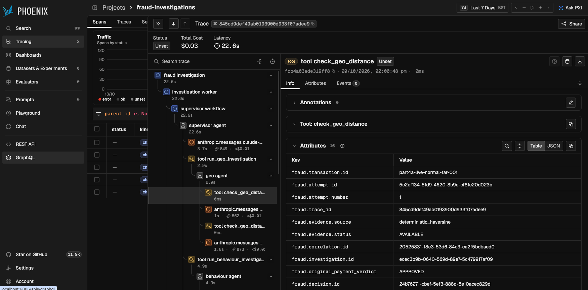
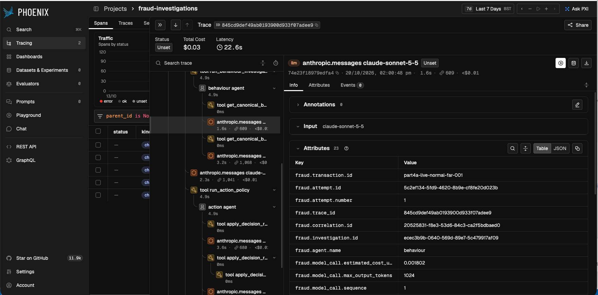

# Real-Time Fraud Detection

An event-driven fraud detection platform combining low-latency, deterministic payment decisions with asynchronous, multi-agent Claude investigations.

**Core design principle: Claude is not in the payment-authorisation path.**

Confluent Kafka and Apache Flink process transaction streams and generate fraud evidence. A versioned, deterministic policy makes the authoritative payment decision, while selected transactions enter a separately governed AI investigation workflow.

This separation allows Claude to investigate suspicious activity and recommend follow-up actions without introducing LLM latency or uncertainty into the initial payment decision.

## Architecture

```text
Synthetic payments
        │
        ▼
Kafka: payments.raw.demo
        │
        ├──────────────► Flink SQL ──────────────► fraud.signals.demo
        │
        ▼
Flink DataStream enrichment
  velocity · merchant hopping · rolling evidence
        │
        ▼
Kafka: payments.enriched.demo
        │
        ▼
Deterministic fraud router ───────────────► PostgreSQL inbox/outbox
  APPROVED · CHALLENGED · BLOCKED                 │
        │                                        ├── immutable decisions
        │ selected cases only                    ├── durable deduplication
        ▼                                        └── budget ledger
Kafka: fraud.investigations.requested
        │
        ▼
Claude investigation worker
  Opus supervisor · Geo · Behaviour · Action
        │
        ▼
Kafka: fraud.investigations.completed
  recommendation kept separate from payment verdict
```

## Design decisions

### Why Claude does not authorise payments

Payment authorisation and fraud investigation have different latency, reliability and governance requirements.

The payment-authorisation path therefore uses Apache Flink to generate behavioural evidence and a deterministic, versioned policy to produce an `APPROVED`, `CHALLENGED` or `BLOCKED` decision.

Claude operates asynchronously, investigating selected transactions after the initial verdict has been recorded.

This separation provides several advantages:

- **Predictable latency:** Payment decisions do not wait for multi-step LLM reasoning or external model API responses.
- **Deterministic outcomes:** The same evidence and policy version produce the same initial decision.
- **Clear accountability:** Every payment verdict can be traced to the evidence and policy that produced it.
- **Fault isolation:** Model latency, API failures or investigation backlogs do not block the payment-decision path.
- **Enforced authority:** PostgreSQL prevents modifications to original payment verdicts. Claude's recommendations are stored separately.

The objective is not to replace deterministic fraud controls with an LLM, but to use Claude where contextual reasoning adds value: interpreting behavioural anomalies, assessing geographical evidence, identifying uncertainty and recommending further investigation.

### Why different Claude models are used

The investigation workflow uses a multi-model architecture, matching model capability and cost to each agent's responsibilities.

| Agent      | Configured model ID    | Design rationale                                                                                                             |
| ---------- | ---------------------- | ---------------------------------------------------------------------------------------------------------------------------- |
| Supervisor | `claude-opus-5-5`      | Coordinates specialist investigations, reconciles evidence and manages multi-step reasoning across the workflow.             |
| Behaviour  | `claude-sonnet-5-5`    | Interprets Flink-generated behavioural evidence, including transaction velocity, merchant diversity and historical activity. |
| Geo        | `claude-haiku-5-5`     | Handles focused geographic assessments using deterministic distance calculations and location provenance.                    |
| Action     | `claude-haiku-5-5`     | Invokes the versioned deterministic action policy and returns a governed recommendation.                                     |

The model selection follows a principle of **allocating reasoning capability where it is most valuable**.

Opus is assigned the supervisory role because it coordinates multiple sources of evidence and handles potentially conflicting findings. Sonnet balances reasoning capability and cost for behavioural interpretation, while Haiku supports narrower, structured tool-use tasks where additional model complexity is less justified.

Geographic calculations and final action-policy enforcement remain deterministic tools rather than model-generated calculations or unconstrained decisions.

This is an initial, workload-driven model allocation, not a claim that these are the optimal models. The evaluation roadmap includes comparing model combinations against evidence-grounding quality, tool-use reliability, latency and API cost.

## What this demonstrates

- **Real-time streaming analytics:** Kafka and Flink process transactions using event-time windows, behavioural enrichment and canonical fraud signals.
- **Deterministic payment authority:** A zero-Claude authorisation path produces `APPROVED`, `CHALLENGED` or `BLOCKED` decisions using versioned policies.
- **Governed AI investigations:** Four logical Claude agents collaborate through Anthropic SDK tool-use orchestration, with deterministic policy enforcement at the action boundary.
- **Immutable decisions:** AI investigations can recommend follow-up actions but cannot overwrite original payment verdicts.
- **Reliable event processing:** PostgreSQL transactional inbox/outbox patterns, durable deduplication and idempotent consumers support at-least-once Kafka delivery.
- **Cost-controlled AI execution:** PostgreSQL-backed budget reservations enforce investigation limits across concurrent workers and process restarts, with live API access disabled by default.
- **End-to-end auditability:** Structured provenance captures transaction evidence, policy decisions, model usage, tool calls, investigation outcomes and estimated costs.

## Validated results

The platform has been exercised through a complete Kafka → Flink → deterministic decisioning → PostgreSQL → Claude investigation workflow.

| Metric                                      | Observed result                       |
| ------------------------------------------- | ------------------------------------- |
| End-to-end payment test                     | 16 transactions processed             |
| Payment outcomes                            | 11 approved, 2 challenged, 3 blocked  |
| Asynchronous investigations                 | 5 completed in the controlled dry-run |
| Live evaluation batch 1                     | 5 investigations · 45 model calls     |
| Batch 1 estimated API cost                  | $0.14583                              |
| Phoenix/OpenTelemetry live evaluation       | 3 investigations · 27 model calls     |
| Observability batch estimated API cost      | $0.0901484                            |
| Combined live evaluation                    | 8 investigations · 72 model calls     |
| Combined eight-case estimated API cost      | $0.2359784                            |
| Expected policy recommendations matched     | 8/8                                   |
| Average live investigation latency          | ~21.4 seconds                         |
| Original payment verdicts modified          | 0                                     |
| Duplicate decisions after fixture replay    | 0                                     |

Live investigations operate asynchronously, independently of the initial payment decision.

The evaluation confirmed that Claude's recommendations can differ from an original payment verdict without altering that authoritative decision.

The eight-case cost is the incremental estimate for those two evaluation batches. The durable budget
ledger also carried a prior $0.02740 baseline, producing a $0.2633784 cumulative estimate after the
Phoenix validation run.

Fraud thresholds are configurable examples. The platform uses at-least-once event delivery with explicit idempotency controls rather than assuming end-to-end exactly-once processing.

## Agent Observability — Phoenix & OpenTelemetry

Arize Phoenix provides end-to-end visibility into the existing Python orchestration built directly on
the Anthropic SDK. OpenTelemetry carries trace context through the investigation worker, Supervisor,
specialist agents and deterministic tools, while OpenInference conventions identify agent, model and
tool spans. The illustrated live investigation completed in approximately 22.6 seconds with an
estimated API cost of $0.03.



*Geographic investigation: the nested Supervisor and Geo-agent path records the
`deterministic_haversine` evidence source, synthetic transaction and investigation identifiers, trace
ID, and the original `APPROVED` payment verdict.*



*Behaviour and action investigation: nested spans expose model selection, latency, token usage and
estimated cost alongside canonical evidence retrieval and deterministic policy execution.*

Every trace can be correlated with PostgreSQL using its investigation and trace identifiers. Phoenix
is the execution-visibility layer; PostgreSQL remains authoritative for immutable payment decisions,
durable cost controls and audit records. Prompts and completions are not exported by default, limiting
sensitive data exposure. Deployment, redaction and trace interpretation details are documented in the
[observability guide](observability/README.md).

## Technology

| Area              | Implementation                                           |
| ----------------- | -------------------------------------------------------- |
| Streaming         | Confluent Kafka 8.1.6, Apache Flink 1.20.2               |
| Decisioning       | Python, deterministic versioned policies                 |
| AI investigations | Anthropic SDK, Claude multi-agent tool-use orchestration |
| Agent observability | Arize Phoenix 20.23.0, OpenTelemetry, OpenInference    |
| Durable state     | PostgreSQL 17, SQLAlchemy, Alembic                       |
| Local runtime     | Podman Compose                                           |
| Verification      | Pytest, Ruff, synthetic integration scenarios            |

## Repository structure

- [`confluent-flink/`](confluent-flink/) — Kafka and Flink infrastructure, Java DataStream enrichment, SQL fraud signals, synthetic transaction generator and job lifecycle scripts.
- [`agents/`](agents/) — Deterministic decision router, Claude investigation agents, asynchronous worker, budget enforcement, database models, migrations and tests.
- [`fraud-decisioning/`](fraud-decisioning/) — PostgreSQL deployment, operational workflows and recovery documentation.
- [`docs/architecture.md`](docs/architecture.md) — System architecture, trust boundaries, agent responsibilities and decision-authority model.
- [`observability/`](observability/) — Optional local Phoenix deployment, OpenTelemetry configuration, trace interpretation and zero-cost smoke test.

## Documentation

- [Streaming and Flink guide](confluent-flink/README.md)
- [Decisioning, recovery and operations](fraud-decisioning/README.md)
- [Agent architecture and security boundaries](docs/architecture.md)
- [Phoenix and OpenTelemetry observability](observability/README.md)

## Security and execution controls

Live Anthropic investigations are disabled by default and require explicit enablement and durable budget approval.

Payment verdicts are protected by database-enforced immutability, while AI recommendations are recorded separately for audit and follow-up.

API credentials and local environment configuration remain outside version control, with safe configuration templates provided in the repository.
